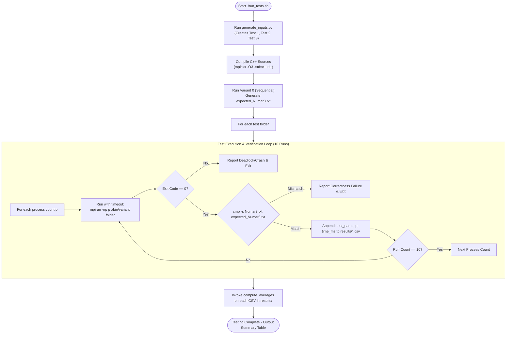

# Architecture & Testing Guide: Global and Local Script Ecosystem

This document explains the testing architecture across the PPD laboratory assignments, detailing the roles and mechanics of **global utility scripts** (in `~/.local/bin/`), **local lab test runners** (`run_tests.sh`, `generate_inputs.py`), how previous homeworks (Lab 0, Lab 1, Lab 2) were benchmarked, and how to structure and execute testing for **Lab 3 (MPI Big Number Addition)** based on the official requirements in `Lab3-MPI/given/Laboratory 3.md`.

---

## 1. Global vs. Local Scripts: Architectural Overview

The testing workflow in this repository relies on a two-tier hierarchy:

```
┌────────────────────────────────────────────────────────────────────────┐
│                        GLOBAL UTILITIES (~/.local/bin)                 │
│   • repeat           : Generic loop runner & metric extractor           │
│   • compute_averages : AWK-based statistical mean calculator            │
│   • run_cpp          : Compile + run C++ via repeat                     │
│   • run_java         : Compile + run Java via repeat                    │
└───────────────────────────────────┬────────────────────────────────────┘
                                    │ Called by / Integrated into
                                    ▼
┌────────────────────────────────────────────────────────────────────────┐
│                        LOCAL LAB HARNESS (LabX/solution/)              │
│   • generate_inputs.py : Deterministic, reproducible dataset generator │
│   • run_tests.sh       : Orchestrator (build, run_and_verify, report)  │
│   • tests/             : Test directories with input/expected files    │
│   • results/           : Raw CSV files and statistical summaries       │
└────────────────────────────────────────────────────────────────────────┘
```

- **Global Scripts (`~/.local/bin/`)**: Installed in user `$PATH`, designed as reusable command-line utilities across all labs for running commands $N$ times, writing stdout metrics to CSV, and computing averages.
- **Local Scripts (`LabX/solution/`)**: Tailored to each assignment's domain (e.g., Matrix Convolution vs. MPI Message Passing), managing input generation, test case folders, binary builds, correctness verification (`cmp`), and orchestrating parameter sweeps.

---

## 2. Evaluation of Global Scripts (`~/.local/bin/`)

The public scripts are located in `~/.local/bin/` (exported in `.bash_profile` / `.zshrc`):

### 2.1. `repeat`
- **What it does**: Takes an iteration count, a target CSV file path, and an arbitrary command with arguments. It runs the command $N$ times, checks exit codes (aborting on failure), extracts the **last line** of stdout using `tail -n 1`, and appends it to the CSV.
- **Role**: Abstracting benchmark iteration loops away from individual source codes.
- **Limitations**:
  - Assumes stdout noise won't pollute the final line.
  - Does not perform output verification between runs.

### 2.2. `compute_averages`
- **What it does**: An AWK script expecting CSV lines with 3 comma-separated fields: `$1` (Problem size/name), `$2` (Thread/Process count), and `$3` (Execution time in milliseconds).
- **Processing**:
  - Groups entries by unique `(size, workers)` keys.
  - Accumulates sum and execution count.
  - Computes and prints the formatted arithmetic mean: `key -> Average: X.XXXX ms (from N runs)`.
- **Role**: Fast post-processing without opening spreadsheet software or writing separate Python scripts.
- **Format Requirement**: Any local runner must output rows as `<test_name>,<workers>,<time_ms>`.

### 2.3. `run_cpp` and `run_java`
- **What they do**:
  - `run_cpp`: Compiles a `.cpp` file with `g++ -O3 -std=c++17`, names the binary after the source file, and invokes `repeat` passing `./binary <input> <output> <threads>`.
  - `run_java`: Compiles `.java` into `bin/` using `javac`, then invokes `repeat` passing `java -cp bin <ClassName> <input> <output> <threads>`.
- **Evaluation in Context of MPI (Lab 3)**:
  - **Incompatible with MPI directly**: Both scripts assume a shared-memory execution model where the thread count is passed as a command-line parameter to a standalone executable (`./exe ...`).
  - MPI requires launching with a process launcher (`mpirun -np <p>` or `mpiexec -np <p>`) and compilation with an MPI wrapper compiler (`mpicxx`), rather than standard `g++`.
  - Therefore, `run_cpp` cannot be used for MPI runs unless extended with an `MPI` execution mode or replaced by a local MPI test runner.

---

## 3. How Previous Homeworks Were Tested

### 3.1. Lab 0 (Sequential Vector Addition)
- **Methodology**: Primitive testing using the global scripts (`run_cpp`, `run_java`).
- Input sizes: $1\,000$, $10\,000$, $100\,000$ elements.
- Execution: `run_cpp main.cpp cpp_data.csv 10 input_1000.txt output.txt 1`.
- Times were averaged across 10 runs using `compute_averages`. Only computational time was measured (excluding I/O).

### 3.2. Lab 1 & Lab 2 (Convolution Matrix — Dynamic, Static, Optimized)
These labs transitioned to a fully automated, self-contained local test harness in `solution/`:
1. **Deterministic Input Generation (`generate_inputs.py`)**:
   - Fixed random seed (`random.seed(42)`) to ensure exact reproducibility across machines.
   - Generated subfolders inside `tests/` (e.g., `tests/1000x1000_k3/`) containing `MatrixF.txt` and `ConvolutionM.txt`.
2. **Compilation**:
   - Compiled all variants with `g++ -O3 -std=c++17` into `bin/` (`sequential`, `horizontal`, `vertical`, static variants, and Java classes).
3. **Reference Baseline**:
   - Prior to parallel runs, the sequential C++ binary ran once on the test folder to produce `expected_output.txt`.
4. **Verification & Execution (`run_and_verify` function in `run_tests.sh`)**:
   - Executed each configuration for `RUNS=10`.
   - Used `cmp -s "$folder/output.txt" "$folder/expected_output.txt"` immediately after each individual run.
   - If a mismatch occurred, execution halted with an explicit error, preventing invalid timings from being logged.
   - Appended valid timing lines (`name,threads,ms`) to `results/*.csv`.
5. **Statistical Aggregation**:
   - Called `compute_averages` on every generated CSV file in `results/`.
6. **I/O Policy**:
   - Measured purely computational time via `std::chrono` / `System.nanoTime()` inside the code; file reading and writing were excluded.

---

## 4. Contextualizing for Lab 3 (MPI Big Number Addition)

According to `Lab3-MPI/given/Laboratory 3.md`, testing Lab 3 has distinct requirements and constraints compared to earlier labs:

### 4.1. Core Requirements & Variants
The assignment requires adding two large numbers ($> 10$ digits) represented as byte digit arrays with the least significant digit at index 0. Input files are `Numar1.txt` and `Numar2.txt`; output must be written to `Numar3.txt`.

| Variant | Communication Type | Process 0 Role | Worker Roles | Required Process Counts ($p$) |
|---|---|---|---|---|
| **Variant 0** | None (Sequential C++11) | Computes entire sum | N/A | $p = 1$ (Baseline) |
| **Variant 1** | Standard blocking / synchronous (`MPI_Send` / `MPI_Ssend`) | Reads chunks, distributes, collects partial sums, writes to file. **Does not sum digits.** | Receives chunks from 0, receives carry from $(id-1)$, computes sum, sends carry to $(id+1)$, sends result to 0. | $p \in \{5, 9, 17\}$ (for Test 1: $p = 5$) |
| **Variant 1.1** | Optimization of Var 1 | Same as Var 1 | Begins adding before receiving carry; merges carry when received. | $p \in \{5, 9, 17\}$ |
| **Variant 2** | Collective (`MPI_Scatter` / `MPI_Gather`) | Reads full numbers, pads with zeros, scatters, **participates in addition**, gathers, writes output. | Adds assigned slice, propagates carry to $(id+1)$, gathers into 0. | $p \in \{4, 8, 16\}$ (for Test 1: $p = 4$) |
| **Variant 3** | Non-blocking asynchronous (`MPI_Isend` / `MPI_Irecv`) | Reads $N/p$ chunks, dispatches with `MPI_Isend`, receives asynchronously, writes to file. | Receives data and carry asynchronously (order between 0 and $id-1$ is not guaranteed), adds, forwards carry. | $p \in \{5, 9, 17\}$ (for Test 1: $p = 5$) |

### 4.2. Critical Differences & Rules Imposed by Lab 3
1. **I/O Must Be Timed**:
   > *"For all variants Include the reading of the numbers in the execution time!"*
   - In Labs 1 and 2, file I/O was excluded. In Lab 3, the timer must start before opening/reading `Numar1.txt` / `Numar2.txt` and stop only when the final result has been determined (or written to `Numar3.txt`).
2. **Deadlock & Synchronous Communication Verification**:
   - The specification mandates that programs must not rely on system buffering:
   > *"To test the correctness of the implementation — replace the standard transmission with the synchronous one `MPI_Ssend`."*
   - Testing scripts must support running under `MPI_Ssend` without hanging.
3. **Execution Model**:
   - Must be executed via `mpirun -np <p> ./bin/<variant> <args>`.
4. **Mandatory Test Cases**:
   - **Test 1 (Validation)**: $N_1 = N_2 = 16$; `Numar1 = "9999 4444 4444 9999"`, `Numar2 = "9999 5555 5555 9999"` with $p = 5$ (or $p = 4$ for Variant 2).
   - **Test 2 (Symmetric Large)**: $N_1 = 10\,000$, $N_2 = 10\,000$ (random digits) with $p \in \{5, 9, 17\}$ (or $\{4, 8, 16\}$).
   - **Test 3 (Asymmetric Large)**: $N_1 = 100$, $N_2 = 100\,000$ (random digits) with $p \in \{5, 9, 17\}$ (or $\{4, 8, 16\}$).
5. **Verification**:
   - Result files (`Numar3.txt`) must be verified against the sequential baseline (`expected_Numar3.txt`) for **every one of the 10 runs**.

---

## 5. Recommended Testing Flow for Lab 3

Adopting the successful patterns from Lab 1 & 2 while accommodating MPI, the recommended architecture for `Lab3-MPI/solution/` is structured as follows:

```
Lab3-MPI/
├── given/
│   └── Laboratory 3.md
└── solution/
    ├── generate_inputs.py         # Creates test folders with Numar1.txt & Numar2.txt
    ├── run_tests.sh               # Local MPI orchestrator & verification runner
    ├── tests/
    │   ├── test1_16_digits/       # Numar1.txt, Numar2.txt, expected_Numar3.txt
    │   ├── test2_10k_10k/
    │   └── test3_100_100k/
    ├── cpp/
    │   ├── variant0_seq.cpp
    │   ├── variant1_blocking.cpp
    │   ├── variant1_1_opt.cpp
    │   ├── variant2_scatter.cpp
    │   └── variant3_async.cpp
    ├── bin/                       # Compiled MPI executables
    └── results/                   # CSV timings per variant and test case
```

### 5.1. Test Orchestrator Flow (`run_tests.sh`)



### 5.2. Key Implementation Safeguards in the Local Script
1. **Deadlock Protection (`timeout`)**:
   Because standard communication bugs in MPI cause permanent deadlocks, individual runs must be guarded by a shell timeout (e.g., `timeout 30s mpirun -np $p ...` or `gtimeout` on macOS).
2. **Standard Output Cleanliness**:
   MPI implementations can emit diagnostic warnings (e.g., dylib version mismatches on macOS). Programs must output the timing metric on the final line or output directly to a dedicated time-log file, ensuring CSV integrity.
3. **Automated Verification**:
   `cmp -s "$folder/Numar3.txt" "$folder/expected_Numar3.txt"` must be executed after each iteration. If output differs, testing stops immediately to flag the defect.
4. **Integration with `compute_averages`**:
   The local script appends lines formatted as:
   ```csv
   10k_10k,5,14.2850
   10k_10k,5,13.9100
   ```
   At the end of testing, it invokes `compute_averages results/variant1_10k_10k.csv`, reusing the global utility seamlessly.

---

## 6. Summary Comparison Matrix Across All Labs

| Feature | Lab 0 | Lab 1 & 2 | Lab 3 (MPI) |
|---|---|---|---|
| **Problem** | Vector Addition | Matrix Convolution | Big Number Addition ($>10$ digits) |
| **Concurrency Model** | Sequential | Multi-threading (`std::thread`, Java Threads) | Distributed Processes (MPI message passing) |
| **Compiler / Runner** | `g++`, `javac` / `./exe` | `g++ -O3`, `javac` / `./exe <threads>` | `mpicxx -O3 -std=c++11` / `mpirun -np <p>` |
| **I/O Timing Policy** | Excluded from timer | Excluded from timer | **Included in execution time** (Explicit requirement) |
| **Worker Counts Tested** | 1 (Sequential) | $p \in \{2, 4, 8, 16\}$ | $p \in \{5, 9, 17\}$ (Var 1, 3); $p \in \{4, 8, 16\}$ (Var 2) |
| **Verification Strategy** | Manual inspection / basic run | Automated `cmp -s` against `expected_output.txt` | Automated `cmp -s` against sequential `Numar3.txt` |
| **Execution Tooling** | Global scripts (`run_cpp`, `run_java`) | Local `run_tests.sh` + global `compute_averages` | Dedicated MPI local `run_tests.sh` + global `compute_averages` |
